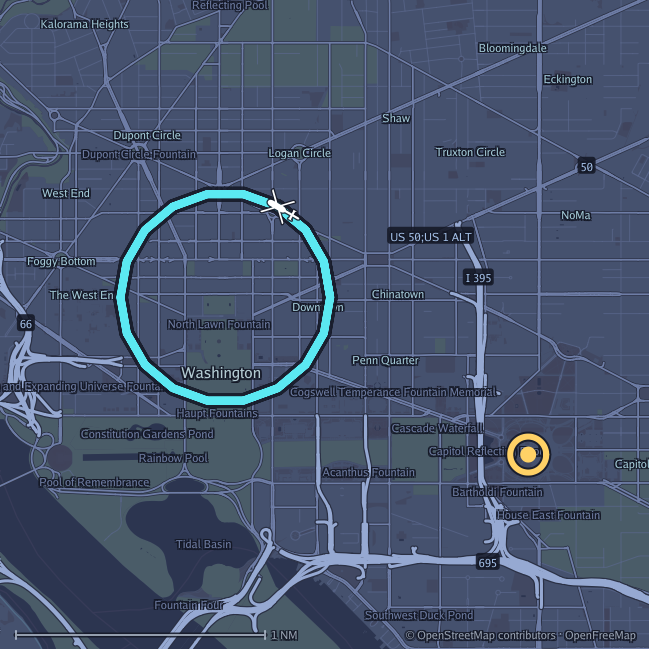
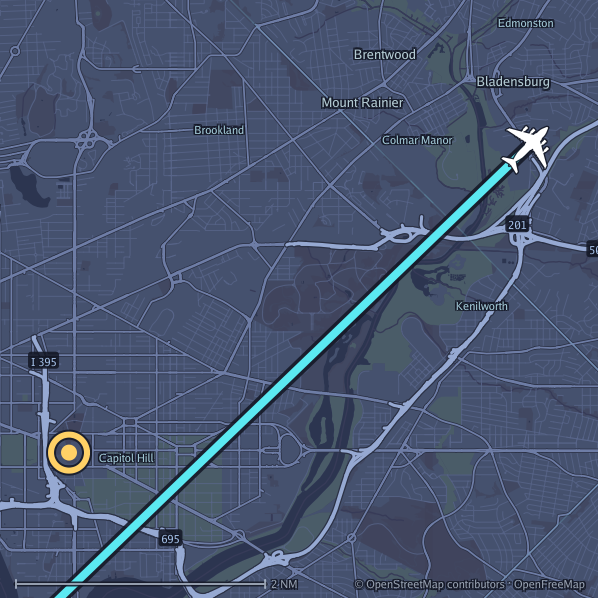
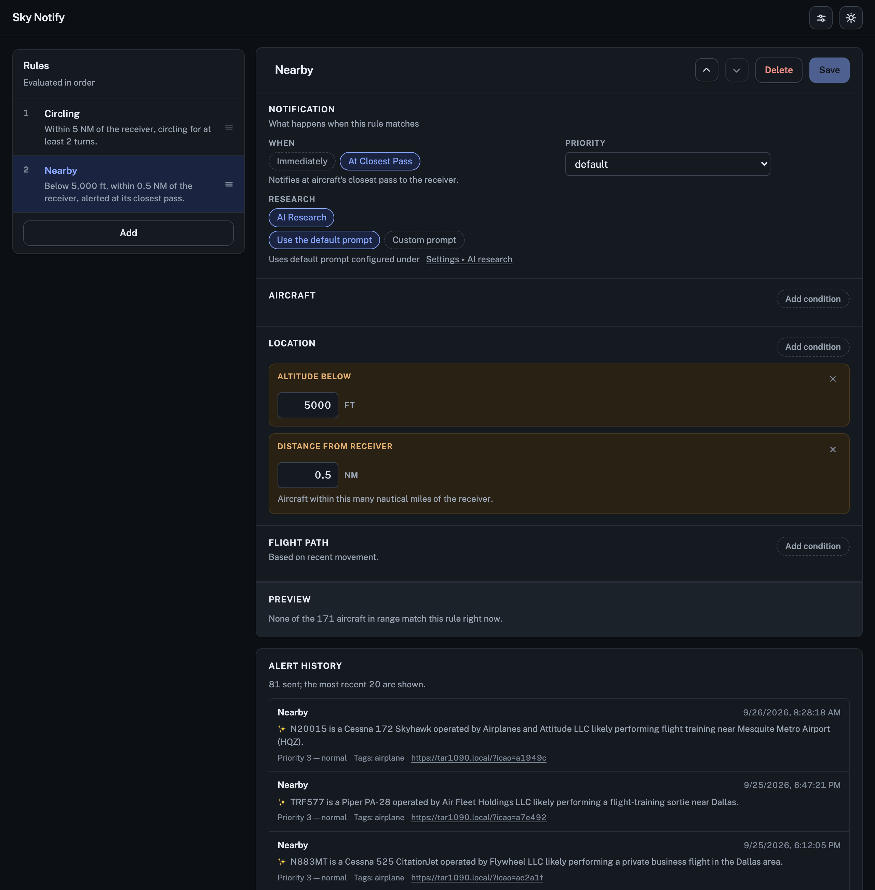
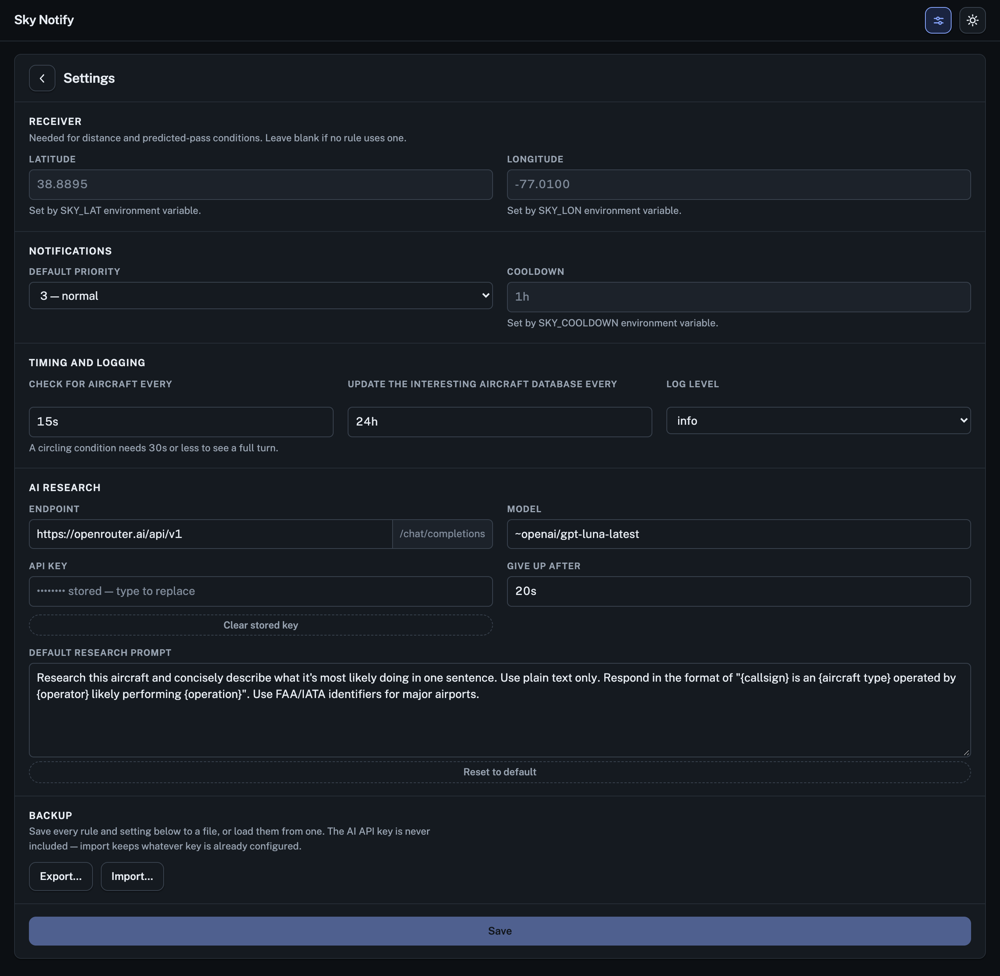

# sky-notify

Get a push notification on your phone when something interesting flies over your house.

sky-notify runs next to your ADS-B receiver ([ultrafeeder](https://github.com/sdr-enthusiasts/docker-adsb-ultrafeeder) / readsb / tar1090),
watches the aircraft it picks up, and sends an [ntfy](https://ntfy.sh) notification when one
matches your rules. It might be a military transport, a police helicopter circling the
neighborhood, or just anything flying low over you. Each alert comes with a map of where the
aircraft is and, if you want it, a one-line AI summary of who it is and what it's probably doing.

<p align="center">
  
  
</p>

## Features

- **Rules you build in a web UI.** Match on operator, aircraft type, category, tags,
  registration, callsign, squawk, altitude, or distance from your receiver. The UI shows
  a live preview of which aircraft each rule would match right now.
- **Flight path detection.** Alert when an aircraft is **circling** (news and police
  helicopters, for example) or is **about to pass over you** within the next few minutes.
- **Alert at the closest pass.** Get the notification once the aircraft has actually gone
  over, with the closest distance it reached, instead of the moment it first shows up.
- **A map in every notification.** Each alert includes a map with your receiver, the
  aircraft drawn as its real silhouette, and its recent track. The map is rendered locally
  with no browser needed.
- **AI research (optional).** Point it at any OpenAI-compatible provider (OpenRouter,
  Ollama, OpenAI, and others) and each alert starts with a short summary like *"N661HD is
  an EC135 operated by the Garland PD air unit, likely performing a patrol orbit."*
- **Built on [plane-alert-db](https://github.com/sdr-enthusiasts/plane-alert-db).** A
  community-curated list of thousands of notable aircraft (military, government, police,
  historic, celebrity jets, and more), kept up to date automatically.
- **Alert history.** See every notification a rule has sent.
- **Cooldowns, priorities, and emergency squawks.** Get one alert per aircraft rather than
  repeats, and set ntfy priority per rule.
- **Configured from the web UI.** Every setting, from your feeder's URL to the ntfy
  server, can be set in the browser. Environment variables are optional.
- **Password-protected web UI.** The first visit asks you to choose a password (or go
  without one), and you can change it later in Settings.
- **Backup and restore.** Export all your rules and settings to a file and import them later.
- **Lightweight.** A single small Go binary in one container, for amd64 and arm64.

## Screenshots

**Rule editor** with live preview and alert history:



**Settings**:



## Quick start

Add this to your `docker-compose.yml`:

```yaml
services:
  sky-notify:
    image: ghcr.io/grahamwetzler/sky-notify:latest
    restart: unless-stopped
    ports:
      - "8080:8080"
    volumes:
      - sky-notify-data:/data
      - sky-notify-config:/config

volumes:
  sky-notify-data:
  sky-notify-config:
```

Then:

1. Run `docker compose up -d`.
2. Open `http://<your-server>:8080`. The first visit asks you to choose a password for
   the web UI. You can also continue without one.
3. In Settings, fill in your feeder's `aircraft.json` URL and an ntfy topic, then save.
   The other fields start with sensible defaults. sky-notify restarts itself with the new
   settings.
4. Subscribe to your topic in the [ntfy app](https://ntfy.sh). On public ntfy.sh anyone who
   knows the topic name can read it, so pick something hard to guess.
5. Add some rules. **Nothing alerts until a rule matches.** Try "In the interesting
   aircraft database" to start.

If you'd rather configure it in the compose file, see
[`docker-compose.yml`](docker-compose.yml) for every environment variable, and
[`config.example.json`](config.example.json) for a starter set of rules.

### Forgot the password?

```sh
docker exec sky-notify /sky-notify -reset-password
```

This removes the stored password. Within a few seconds, the next visit to the web UI asks
you to choose a new one, just like the first visit. Until someone does, the UI is open, so
do it straight away.

## Configuration

Everything can be set in the web UI's Settings page. Each setting can also be given as an
environment variable, which then wins and locks that field in the UI. Settings marked *
must be set one way or the other; until they are, sky-notify serves only the web UI so you
can fill them in.

| Variable | Default | |
|---|---|---|
| `SKY_SOURCE_URL` * | | URL or file path of your feeder's `aircraft.json` |
| `SKY_NTFY_URL` * | | `https://ntfy.sh` or your own ntfy server |
| `SKY_NTFY_TOPIC` * | | the topic to publish to |
| `SKY_DB_BASE_URL` * | | where to download plane-alert-db from |
| `SKY_DB_FILES` * | | which database files to use, comma-separated |
| `SKY_CACHE_DIR` * | | where to keep the cached database and alert history |
| `SKY_UI_PASSWORD` | | password for the web UI, instead of the one chosen in the UI |
| `SKY_LAT` / `SKY_LON` | | your receiver's location, needed for distance and flyover rules |
| `SKY_NTFY_TOKEN` | | ntfy access token (or `SKY_NTFY_USER` + `SKY_NTFY_PASSWORD`) |
| `SKY_TAR1090_URL` | | makes notifications link to the aircraft on your tar1090 map |
| `SKY_COOLDOWN` | `24h` | how long to wait before alerting on the same aircraft again |
| `SKY_MAP_ENABLED` | `true` | attach a map to each notification |
| `SKY_AI_URL` / `SKY_AI_MODEL` / `SKY_AI_KEY` | | AI research provider |
| `SKY_LISTEN` | `:8080` | address for the web UI and `/healthz` |
| `SKY_CONFIG_DB` | `/config/config.db` | where the settings are stored (environment only) |

Saving the service settings (feed, ntfy, database, map, storage and network) restarts
sky-notify in place to apply them. Rules and the other settings take effect within a few
seconds without a restart.

sky-notify serves plain HTTP, so the password is sent unencrypted. That's fine on a home
network you trust; anywhere else, put it behind a reverse proxy that serves HTTPS (Caddy,
Traefik, nginx) and don't expose port 8080 directly.

## Development

```sh
go test -race ./...
go vet ./...
docker build -t sky-notify .
```

Pushes to `main` publish a multi-arch image to
[`ghcr.io/grahamwetzler/sky-notify`](https://github.com/grahamwetzler/sky-notify/pkgs/container/sky-notify).

## Credits & license

sky-notify is MIT licensed. See [`LICENSE`](LICENSE).

- The aircraft list is [plane-alert-db](https://github.com/sdr-enthusiasts/plane-alert-db)
  by the SDR Enthusiasts, used under ODbL 1.0 / DbCL 1.0.
- Aircraft data comes from [readsb](https://github.com/wiedehopf/readsb) via
  [ultrafeeder](https://github.com/sdr-enthusiasts/docker-adsb-ultrafeeder).
- Map tiles are from [OpenFreeMap](https://openfreemap.org) and © OpenStreetMap contributors.
- The aircraft silhouettes in [`icons.json`](internal/app/icons.json) come from
  [tar1090](https://github.com/wiedehopf/tar1090) and are licensed GPL-2.0-or-later.
  That file and [`icons.go`](internal/app/icons.go) carry tar1090's license.
